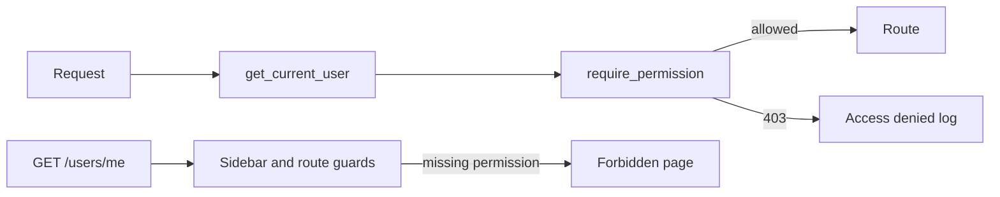

# Full Stack FastAPI Template

[](../../actions/workflows/test-docker-compose.yml)
[](../../actions/workflows/test-backend.yml)

## Technology Stack and Features

- ⚡ [**FastAPI**](https://fastapi.tiangolo.com) for the Python backend API.
  - 🧰 [SQLModel](https://sqlmodel.tiangolo.com) for the Python SQL database interactions (ORM).
  - 🔍 [Pydantic](https://docs.pydantic.dev), used by FastAPI, for the data validation and settings management.
  - 💾 [PostgreSQL](https://www.postgresql.org) as the SQL database.
- 🚀 [React](https://react.dev) for the frontend.
  - 🧩 Built into the backend application and served by FastAPI on the same domain as the API.
  - 💃 Using TypeScript, hooks, [Vite](https://vitejs.dev), and other parts of a modern frontend stack.
  - 🎨 [Tailwind CSS](https://tailwindcss.com) and [shadcn/ui](https://ui.shadcn.com) for the frontend components.
  - 🤖 An automatically generated frontend client.
  - 🧪 [Playwright](https://playwright.dev) for end-to-end testing.
  - 🦇 Dark mode support.
- ☁️ [FastAPI Cloud](https://fastapicloud.com) for deployment.
- 🐋 [Docker Compose](https://www.docker.com) for local services and self-hosted deployment.
  - 📞 [Traefik](https://traefik.io) as a reverse proxy with automatic HTTPS.
- 🔒 Secure password hashing by default.
- 🔑 JWT (JSON Web Token) authentication.
- 📫 Email-based password recovery.
- ✉️ [React Email](https://react.email) for email templates.
- 📬 [Mailpit](https://mailpit.axllent.org) for local email testing during development.
- ✅ Tests with [Pytest](https://pytest.org).
- 🏭 CI (continuous integration) and CD (continuous deployment) based on GitHub Actions.

### Dashboard Login


### Dashboard - Admin


### Dashboard - Items


### Dashboard - Dark Mode


### React Email Templates


### Mailpit - Local Email Testing


### Interactive API Documentation


## Role-based access

Each user has one role: `admin`, `manager`, or `member`. The API stores that role on the user and checks it through a single permission map in `backend/app/core/authorization.py`. A route asks for a permission, for example `users:create`, and FastAPI dependency `require_permission` allows the call only when the caller's role includes it. A denied call returns HTTP 403 and is written to the log.

`GET /api/v1/users/me` returns the caller's `role` and the `permissions` list for that role. The React app does not keep a second copy of the matrix. The sidebar and the route guards call `hasPermission` with that list, so a new role is added in the backend map and shows up in the UI after the next login response.

Signing up always creates a `member`. Only an admin can assign a role, and only through the create-user and update-user endpoints. Updating your own profile cannot change your role.



| Action | admin | manager | member |
| --- | --- | --- | --- |
| List users | yes | yes | no |
| Create a user | yes | no | no |
| View metrics | yes | yes | no |
| Update or delete any user, including role | yes | no | no |
| View and update own profile, items, and dashboard | yes | yes | yes |
| Delete own account | no | yes | yes |

A manager who opens `/admin` sees the user table and cannot create, edit, or delete accounts. A member who opens `/admin` or `/metrics` directly sees an Access Denied page.

### Run locally

Copy the example env file, start Postgres, apply migrations, then start the API and the Vite app. The migration `c4a8e1b27d90` replaces `is_superuser` with `role`. `scripts/prestart.sh` also creates the three seed users when they are missing.

```console
cp .env.example .env
cp frontend/.env.example frontend/.env
docker compose up -d db mailpit
cd backend
uv sync
uv run bash scripts/prestart.sh
uv run fastapi dev
```

In another terminal, from `frontend/`:

```console
bun install
bun run dev
```

The UI is at `http://localhost:5173`. The API docs are at `http://localhost:8000/docs`.

Seed accounts come from `.env.example`:

| Role | Email | Password |
| --- | --- | --- |
| admin | admin@example.com | changethis |
| manager | manager@example.com | managerpass |
| member | member@example.com | memberpass |

Backend tests, from `backend/`:

```console
uv run pytest
```

More detail on Docker Compose and Alembic is in [backend/README.md](./backend/README.md) and [development.md](./development.md).

## How to Use It

Click the **Use this template** button at the top of this page to create a new repository.

## Backend Development

Backend docs: [backend/README.md](./backend/README.md).

## Frontend Development

Frontend docs: [frontend/README.md](./frontend/README.md).

## Deployment

FastAPI Cloud deployment: [deployment.md](./deployment.md).

Self-hosted deployment with Docker Compose: [deployment-docker-compose.md](./deployment-docker-compose.md).

## Development

General development docs: [development.md](./development.md).

This includes the local FastAPI and Vite workflow, Docker Compose services, `.env` configuration, and more.

## Release Notes

Check the file [release-notes.md](./release-notes.md).

## License

The Full Stack FastAPI Template is licensed under the terms of the MIT license.
